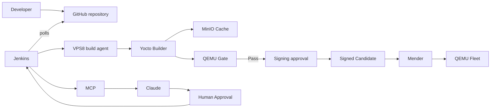

# Architecture Overview

## Purpose

The system separates source control, orchestration, build execution, cache, virtual validation, release packaging, OTA control, fleet execution, and AI diagnostics. GitHub hosts the Git repository only; Jenkins orchestrates all CI, release and promotion jobs, with approval gates before signing and deployment. The tested artifact is promoted immutably.

## Key Decisions

- Build and release implementation lives in repository scripts, not CI-specific logic.
- Jenkins is the only CI/CD orchestrator; GitHub hosts the Git repository only (ADR-011).
- Signing and OTA promotion run only in the dedicated Jenkins release jobs, after named approval and on the isolated release agent; the CI and diagnostic jobs cannot sign or deploy.
- QEMU is a virtual validation gate, not physical-board certification.
- Promotion uses the exact tested artifact.
- AI remains advisory and least-privileged.

## Failure Handling

Failures must be classified, retained as evidence, and prevented from silently producing a release. Timeouts, cleanup, retries, and escalation are component responsibilities.

## Evolution

Any move to shared Project A infrastructure must preserve artifact identity, approval boundaries, least privilege, and evidence continuity.
