# Mender OTA Explained, with a Web UI Demo

Part 1 explains how a Mender over-the-air (OTA) update works, using the SensorNode setup in this repository. Part 2 is a demo script that drives the whole update from the Mender web UI, with the terminal used only to power the device on. Every UI step, label and timing in Part 2 comes from a full rehearsal through the UI on 2026-11-16 against the server on `192.168.0.109`.

For the scripted variant and the overall demo flow, see the [Demo Guide](demo-guide.md). For how the image is built, see [Mender OTA Step by Step](mender-ota-step-by-step.md).

## Part 1 — How Mender OTA works

### The problem it solves

A device in the field has one job: keep working. An update that bricks it means someone has to travel to it. Mender's answer is to never overwrite the running system. The device keeps two copies of its root filesystem, writes the update into the spare one, tries it, and only keeps it if it proves healthy. Otherwise it goes back to the copy it was running before.

### The moving parts

| Part | Where it runs here | What it does |
|---|---|---|
| **Mender server** | 15 containers on the host (`integration-385-*`), behind `https://docker.mender.io` | Holds devices, software and deployments; hands out updates; collects status and logs |
| **API gateway** (Traefik) | `:443` on the host | Single entry point: `/api/devices/*` for devices, `/api/management/*` for the UI and scripts |
| **deviceauth** | server | Decides which devices are allowed to talk to the server (authentication sets) |
| **inventory** | server | Stores what each device reports about itself (device type, installed artifact, network, …) |
| **deployments** | server | Stores artifacts (in the bundled MinIO/S3) and tracks every deployment, per device |
| **Web UI** | server, `https://docker.mender.io/ui/` | Everything in Part 2 |
| **Mender client** (`mender-update` 5.1.0) | inside the device image (`meta-mender`, `mender-full`) | Polls the server, downloads, installs into the spare partition, reboots, runs state scripts, commits or rolls back, reports back |
| **Device** | QEMU `sensornode-canary-01` (`qemuarm64`, UEFI + GRUB) | A real Yocto image with a real A/B disk, just virtual hardware |

### Key ideas, in the order the demo shows them

**Device identity.** Every device introduces itself with an identity. SensorNode uses its SMBIOS serial (`device_id=sensornode-canary-01`, from `mender-device-identity` in `meta-sensornode`). It is identical on both root filesystems, so the device stays the same device across updates.

**Authentication sets.** On first boot the client creates a key pair and sends its identity plus public key to the server. That pair is an *authentication set*. Nothing happens until an operator, or a pre-authorisation in production, **accepts** it. A factory-fresh disk creates a new key. Because the identity is already known, the new key appears as a **new request** on the existing device, not as a new pending device. Accepting the new key automatically rejects the old one.

**Inventory.** Once accepted, the device reports what it is running. `artifact_name` (for example `sensornode-0.3.0-101-ff2bd03`) is what the UI shows as *Current software*.

**Artifact.** A `.mender` file built by Yocto. It contains:

- a header with the artifact name and the device types it is compatible with (`qemuarm64`)
- the payload, here a full root filesystem (`rootfs-image`, about 45 MB)
- **state scripts** embedded in the artifact. Ours is the health gate described below.
- optionally a signature (signing is on the roadmap; see [Release Security Step by Step](release-security-step-by-step.md))

The artifact name is unique per build (`sensornode-<version>-<build>-<commit>`). The client compares it with what is installed and skips an update whose name is already installed.

**Release.** In the UI, artifacts with the same name form a *release* (UI menu: **Software**). Ours are `sensornode-0.3.0-102-ff2bd03` (healthy) and `sensornode-0.3.0-103-ff2bd03-broken` (built with `SENSORNODE_FAILURE_MODE=health`, so `/health` returns 503).

**Deployment.** One release sent to a set of devices: a group, *All devices*, or devices picked one by one. The server tracks each device's progress separately.

### The disk: why a bad update cannot brick the device

```text
/dev/vda (GPT)
├── vda1  /boot/efi   UEFI + GRUB, and the GRUB environment that says which slot to boot
├── vda2  rootfs A    ┐ one is running, the other is spare;
├── vda3  rootfs B    ┘ an update is always written to the spare one
└── vda4  /data       persistent: Mender state, device key, survives every update
```

The running system is never modified. If anything goes wrong before the commit, the device simply boots the slot it came from.

### One update, step by step

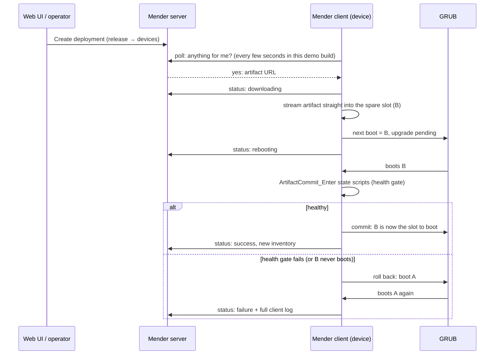

What the UI shows for the device during the update (observed): **Downloading → Rebooting → Installing → Success** or **Fail**. The second *Installing* is the client on the new slot running the health gate and committing.

### Our health gate

`ArtifactCommit_Enter_50_sensornode-health` (in `meta-sensornode/dynamic-layers/mender/…/sensornode-mender-config/files/`) travels inside every artifact and runs on the new slot before the commit. For up to 120 seconds it checks:

1. `sensornode.service` is active
2. `curl http://127.0.0.1:8080/health` succeeds
3. `systemctl --failed` lists nothing

If all three pass, the script exits 0 and Mender commits. If they are still failing after 120 s, it prints `sensornode health gate failed after 120s; refusing commit` plus the service status and exits 1. Mender then rolls back. That message is exactly what the deployment log in the UI shows.

This is the key point of the demo. The broken image **boots fine**, and the kernel, systemd and the app process are all up. During the gate the device even answers `/version` with the new `0.3.0-103`. Only the application-level health check knows it is broken, and it stops the commit.

### Where the server stops and the device takes over

The server never "pushes" an update and never decides about rollback. It publishes what a device should run. The device pulls it, decides from its own health gate whether to keep it, and reports what happened. That is why rollback works even if the server or network disappears after the download.

## Part 2 — Demo with the Mender web UI

### What is shown in the UI, and what is not

| Step | UI | Terminal |
|---|---|---|
| Fleet overview, devices, inventory, installed software | yes | — |
| Releases and their artifacts | yes | — |
| Power on the device from the factory disk | — | yes (QEMU is not managed by Mender) |
| Accept the device's new key | yes | — |
| Create the healthy and the broken deployment | yes | — |
| Watch progress, see success / failure, read the device log | yes | — |
| Watch the device version change | optional | terminal C (`/version` loop) |
| Boot sequence, GRUB slot switch | — | terminal B (serial log) |

Not shown because they need a paid plan: phased rollouts, pauses between phases, retries per device, dynamic groups, audit log. They appear in the UI with *Professional* or *Enterprise* badges; mention them, don't click them.

### Before you start

1. Section 1 and 2 of the [Demo Guide](demo-guide.md): `scripts/demo-services-up.sh --check` all `PASS`, laptop `/etc/hosts` entry, Mender UI logged in.
2. No canary running: `pgrep -fa 'qemu-system-aarch64 -name sensornode-canary-01'` prints nothing.
3. Terminals B (serial log) and C (`/version` loop through the SSH tunnel) ready, as in the demo guide.
4. Browser: Mender UI at **Dashboard**. Zoom to 90 % so the side panels fit on a projector.

### Step 1 — The fleet at a glance (2 min)

**Dashboard** shows accepted devices and recent deployments, including the history of earlier runs.

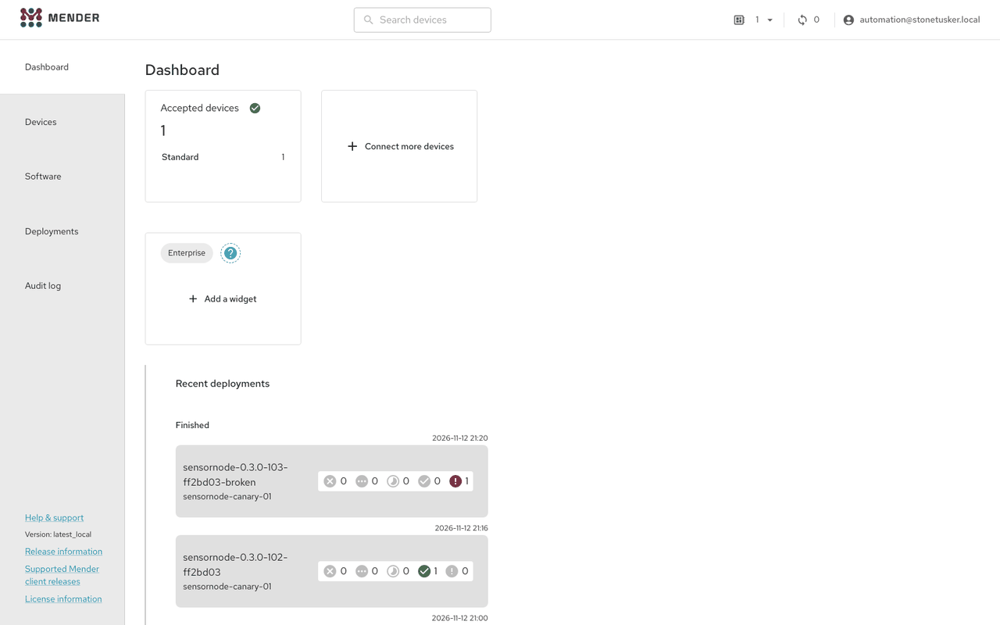

**Software** lists the two releases. Click `sensornode-0.3.0-102-ff2bd03`: one artifact, device type `qemuarm64`, type `rootfs-image`, 45.55 MB.

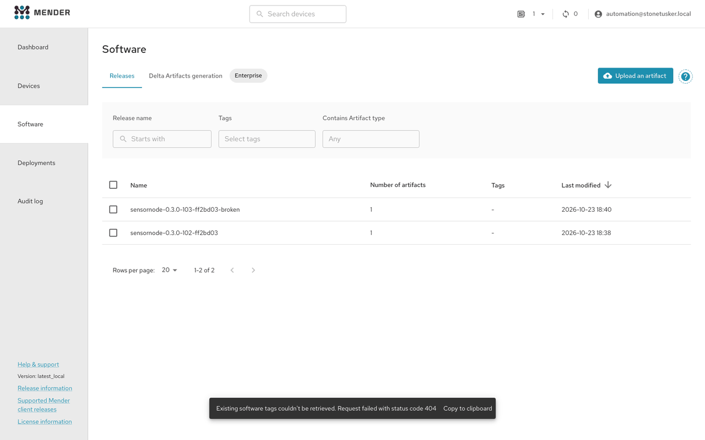

> "Every build gets a unique name: version, build number, commit. From any device you can trace back to the exact source."

### Step 2 — Power on a factory-fresh device (terminal, about 30 s)

On the host (terminal A):

```bash
cd ~/tuskerblueprint-embedded
DISK_IMAGE=$HOME/tbtest/ota-inputs/101/sensornode-image-release-qemuarm64.uefiimg RESET_DISK=1 \
DEVICE_NAME=sensornode-canary-01 APP_PORT=18091 SSH_PORT=12291 \
  setsid qemu-fleet/launch/qemu-device.sh >/tmp/canary.log 2>&1 </dev/null &
```

`RESET_DISK=1` gives a factory-fresh disk on `0.3.0-101`. Terminal B shows UEFI → GRUB → systemd. Terminal C starts answering `0.3.0-101` after 20–30 s.

### Step 3 — Accept the device (UI, under 1 min)

**Devices** → the canary now shows status **New Request**. It is not under *Pending*, because the identity is already known and only the key is new.

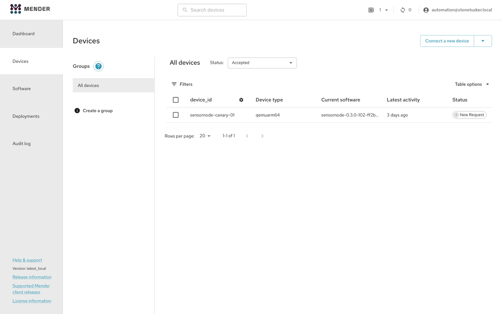

Click the device → **Identity** tab → **Authentication sets**. The top row is **New / Pending** with the key just sent by the device.

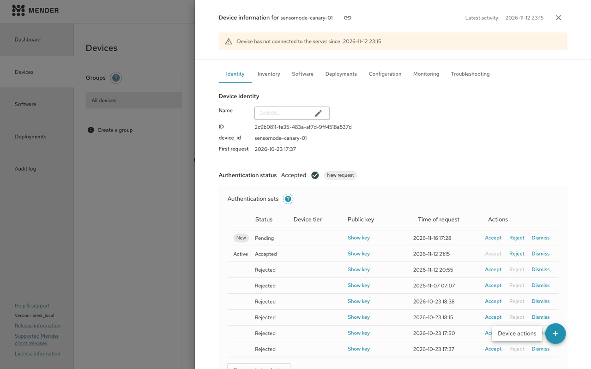

Click **Accept** on that row. The UI asks *"Set to: accepted? … The previously accepted public key will be rejected automatically in favor of this new key."* Click **Confirm**.

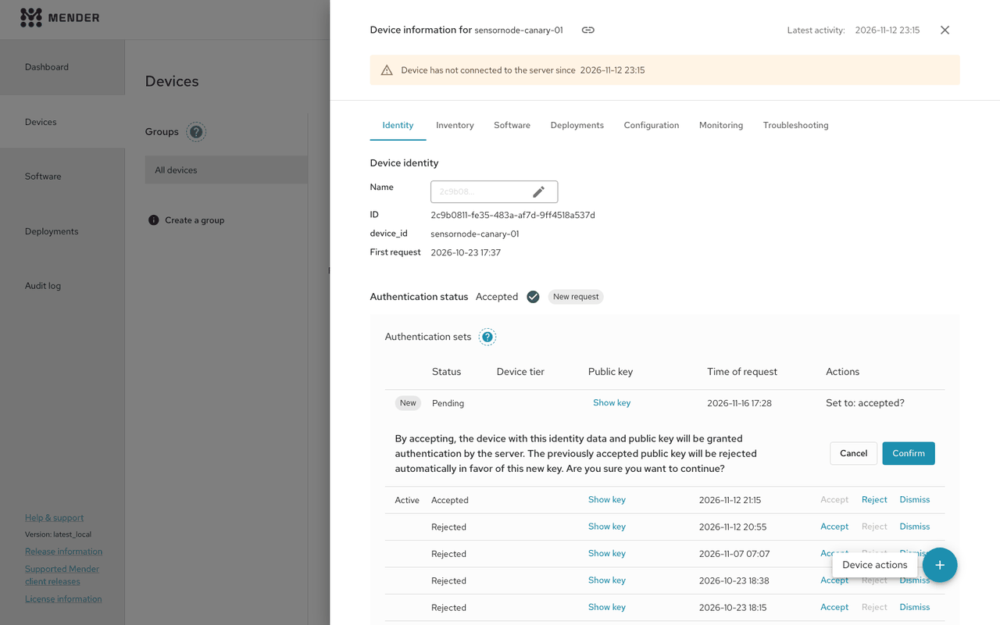

> "In production this step is pre-authorisation at the factory. Here we do it by hand so you can see that no device gets updates until it is trusted."

Within a few seconds the device authenticates and reports its inventory. **Devices** shows *Current software* `sensornode-0.3.0-101-ff2bd03` and status **Accepted**. The device's **Software** tab shows the root filesystem version and checksum, and **Inventory** shows `artifact_name`.

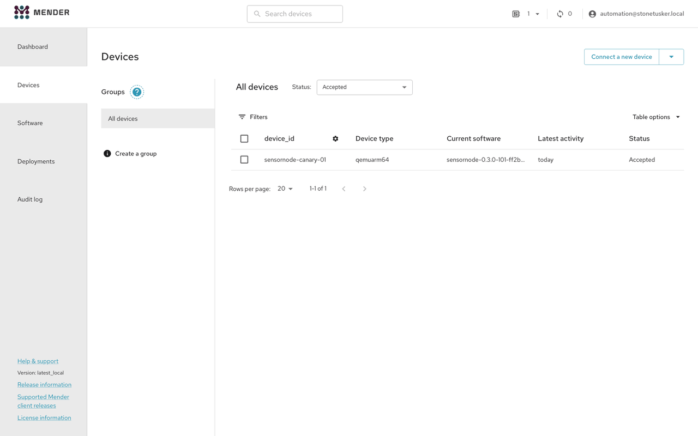

### Step 4 — Deploy the healthy release (UI, about 80 s)

Use the release page to start the deployment (see [Known UI issue](#known-ui-issue-on-this-server) for why):

1. **Software** → click `sensornode-0.3.0-102-ff2bd03`.
2. Bottom-right **Release action** button → **Create a deployment for this release**.

   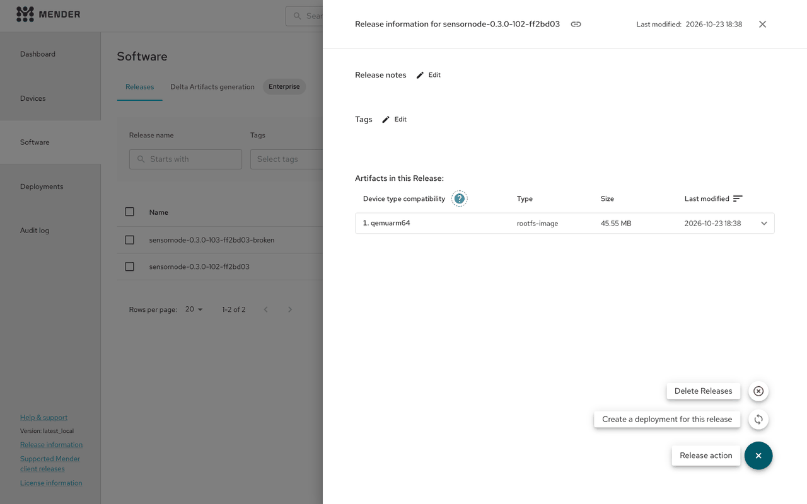

3. **Select a device group to target** → **All devices**. The UI confirms *"Estimate 1 device will be targeted"*. The software field is already filled in.

   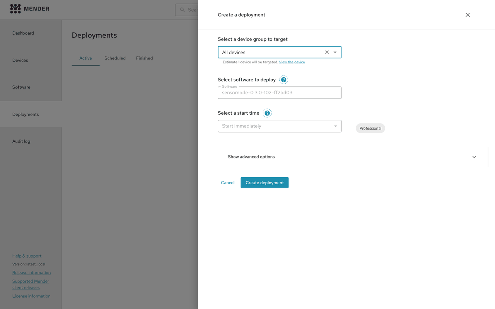

4. Leave the start time at **Start immediately** → **Create deployment**.
5. **Deployments → Active** → **View details**.

What to point at while it runs (times from the rehearsal):

| Time | Device status in the UI | Terminals |
|---|---|---|
| ~7 s | **Downloading** | — |
| ~30 s | **Rebooting** | B: reboot, GRUB boots the other slot. C: empty replies for a moment (expected) |
| ~70 s | **Installing** (health gate on the new slot) | C: `0.3.0-102` |
| ~80 s | **Success**, deployment moves to *Finished* | — |

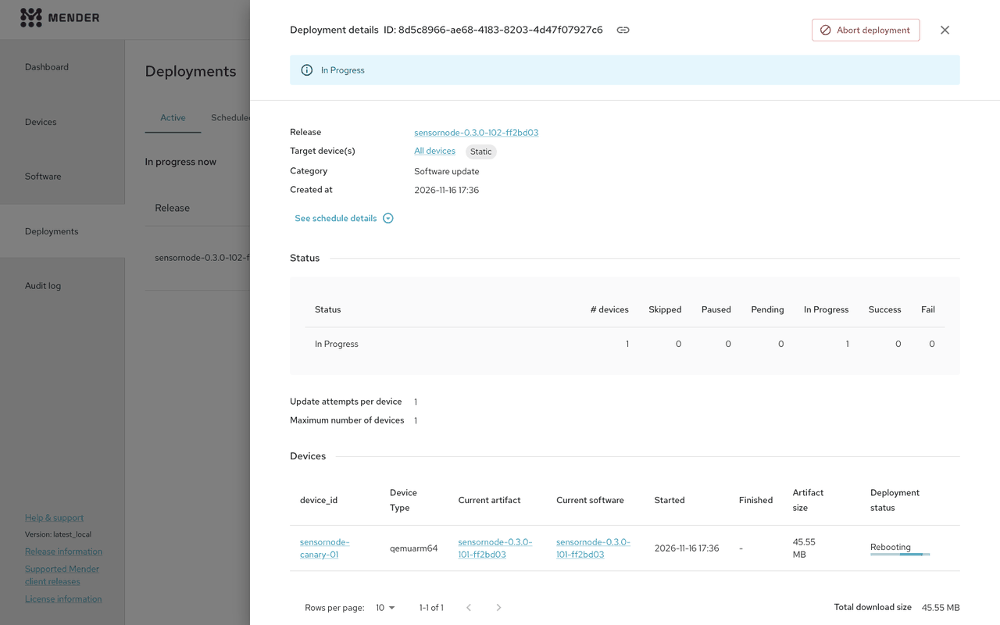

Back in **Devices**, *Current software* is now `sensornode-0.3.0-102-ff2bd03`.

> "Installed into the spare slot, rebooted, proved healthy, committed. The old slot is still there, untouched, as the way back."

### Step 5 — Deploy the broken release (UI, about 4.5 min)

Same steps as Step 4 with `sensornode-0.3.0-103-ff2bd03-broken`.

| Time | Device status in the UI | What to say / show |
|---|---|---|
| ~7 s | **Downloading** | "This image is broken on purpose: the app reports unhealthy." |
| ~30 s | **Rebooting** | B: the new slot boots normally |
| ~2 min | **Installing** | C: the device answers **`0.3.0-103`**. "It boots, it runs, it even reports its version. A boot check would call this a success." |
| ~2–4 min | **Installing** | the health gate keeps getting `503` from `/health` for 120 s |
| ~4 min | (reboot) | B: Mender reboots into the previous slot. C: back to **`0.3.0-102`** |
| ~4.5 min | **Fail**, *"1 device failed to update"* | the deployment moves to *Finished* |

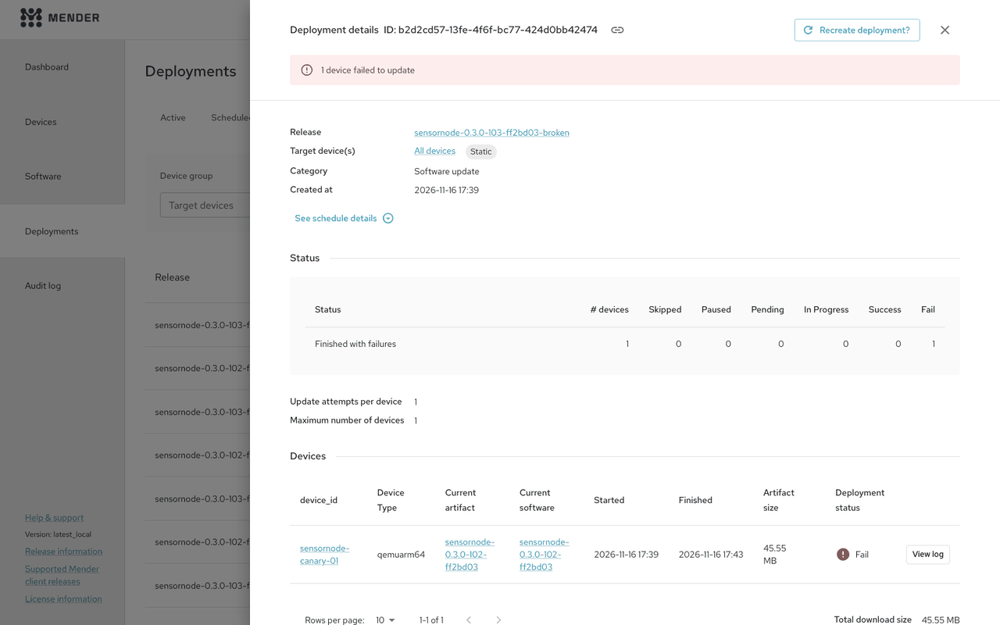

Open **View log** on the device row. The device sent its own log:

```text
Running State Script: /var/lib/mender/scripts/ArtifactCommit_Enter_50_sensornode-health
Collected output (stderr) while running script: sensornode health gate failed after 120s; refusing commit
Calling `reboot` command and waiting for system to restart.
```

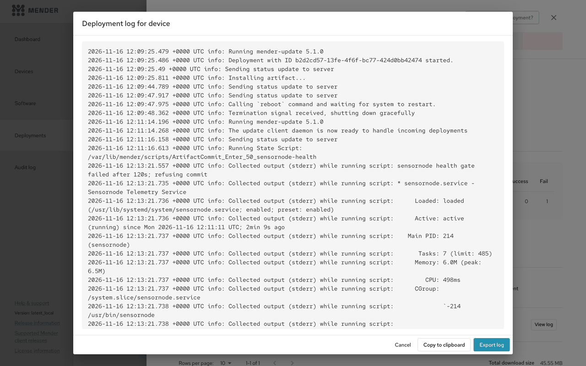

> "The broken image booted fine. Only the health gate knew, and the device healed itself. Nobody touched it."

Finish on the device: **Devices** → canary → **Deployments** tab. It shows the whole history, success and failure, each with a link to its deployment. *Current software* is still `sensornode-0.3.0-102-ff2bd03`.

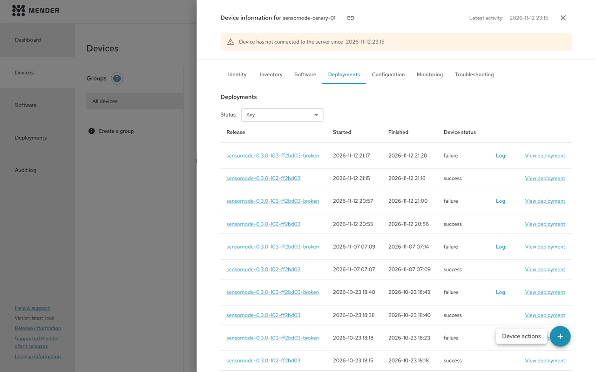

### Step 6 — Options worth mentioning (no clicking needed)

In **Create a deployment → Show advanced options**:

- **Force update if the software is already installed**: without it, a device already running that release is skipped.
- **Limit deployment to a maximum number of devices**.
- *Retries* (Professional), *rollout patterns* and *pauses between update steps* (Enterprise): the phased canary → pilot → fleet rollout on our roadmap.

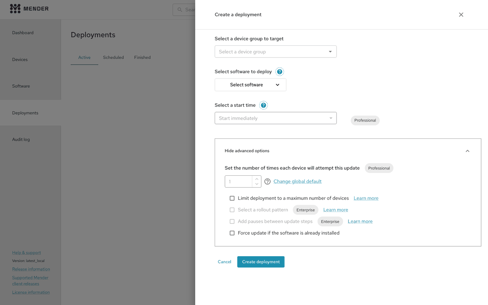

The **Abort deployment** button appears at the top of an active deployment's details.

### After the demo

Stop the device so the scripted demo can use the port again:

```bash
pkill -f 'qemu-system-aarch64 -name sensornode-canary-01'
```

Each UI run adds two finished deployments and one more rejected key to the device's history. Both are harmless. To repeat the demo, start again at Step 2: the factory disk resets the device to `0.3.0-101` with a new key.

### Known UI issue on this server

The Mender GUI on the host is a newer build (`mendersoftware/gui:main`) than the deployments service supports. The GUI calls `/api/management/v1alpha1/deployments/software`, which returns 404, so:

- in **Deployments → Create a deployment**, **Select software** shows *"There was an error while listing software Request failed with status code 404"* and **Results (0)**
- the toast *"Existing software tags couldn't be retrieved"* appears on Software and Deployments pages

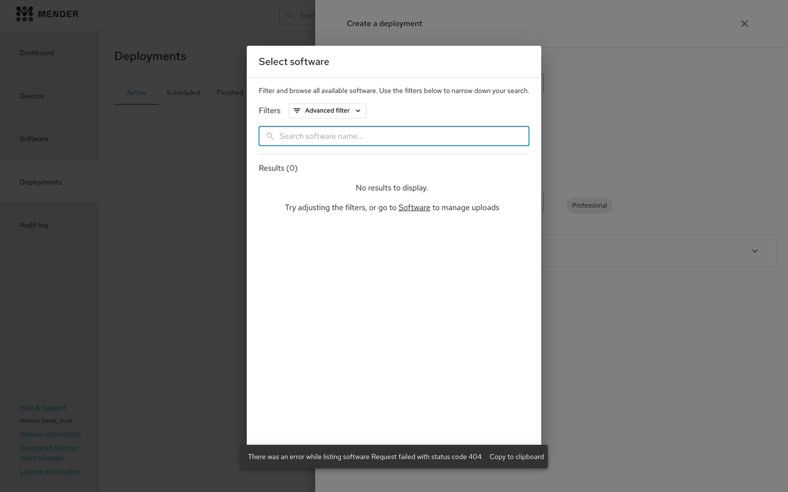

The same happens from **Devices → Device actions → Create deployment for this device**, because it opens the same picker. **Workaround (used above):** start from **Software → release → Release action → Create a deployment for this release**. The software is then filled in and the picker is never needed. The proper fix is to pin all Mender server images to one matching release instead of `main`, which is already listed as an open point in [OTA Deployment Summary](../15-evidence/ota-deployment-summary.md).

### More than one device

*All devices* targets every accepted device. With more than one, put the canary in its own static group: select it in **Devices** → **Device actions** → **Add selected device to a group** (for example `canary`). Then pick that group under **Select a device group to target**. This path was not exercised in the 2026-11-16 rehearsal.

### Troubleshooting during the demo

| Symptom | Cause | Action |
|---|---|---|
| Device not under *Pending* | the identity is known; only the key is new | Use the device's **Identity** tab and accept the **New / Pending** set |
| Banner *"Device has not connected to the server since …"* | QEMU is not running, or it has not booted yet | Check terminal B. Start the device (Step 2). |
| Deployment shows **Skipped** | the device already runs that release | Expected; to reinstall, tick **Force update if the software is already installed** |
| Stuck in **Downloading** | the device cannot resolve the artifact URL | `docker logs --tail 50 integration-385-mender-deployments-1`; check `DEPLOYMENTS_AWS_EXTERNAL_URI` |
| Empty *Select software* list | [Known UI issue](#known-ui-issue-on-this-server) | Start from the release page |
| Live run fails | — | Fall back to the scripted run (`mender/demo-scenarios/run-ota-e2e.sh`) or the recorded evidence, as in the demo guide |

## Rehearsal record

| Date | Run | Result |
|---|---|---|
| 2026-11-16 | Full UI-driven run (device boot from terminal, everything else in the UI) | Key accepted in the UI; healthy `0.3.0-102` **Success** in about 80 s; broken `0.3.0-103-broken` **Fail** with automatic rollback to `0.3.0-102` in about 4.5 min. Deployment log shows the health gate refusal. |
